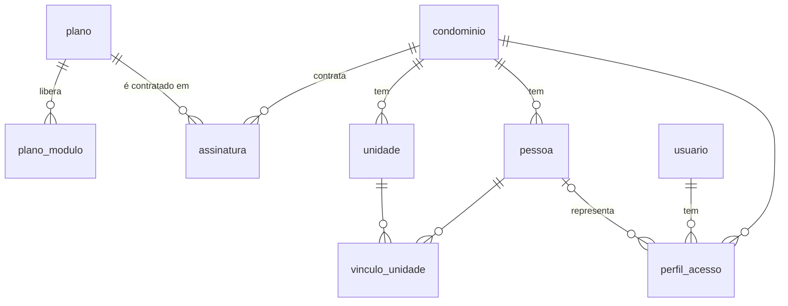

# Etapa 2 — Cadastro base

- **Branch:** `feature/cadastro-base` (criada a partir de `feature/fundacao`)
- **Commit:** `5eadd15`
- **Concluída em:** 13/11/2026

## Objetivo

Criar as tabelas de que todo o resto depende: quem é o cliente (condomínio), o que ele contratou
(plano e assinatura), o que existe nele (unidades), quem está ligado a ele (pessoas) e quem entra
no sistema (usuários e perfis).

## Modelo de dados

Migração: `src/main/resources/db/migration/V1__cadastro_base.sql`



### Módulo `plataforma`

| Tabela | Para que serve | Observações |
|---|---|---|
| `plano` | Planos vendidos pelo Condomix | Global (sem `tenant_id`). `tipo`: `BASE` ou `ADICIONAL` |
| `plano_modulo` | Módulos que cada plano libera | `DOCUMENTOS`, `FINANCEIRO`, `RESERVAS`, `WHATSAPP` |
| `condominio` | O cliente (tenant) | `tipo`: residencial vertical (prédios), horizontal (casas), comercial ou misto |
| `assinatura` | Plano contratado por um condomínio | `periodicidade`: mensal, semestral, anual. `status`: teste, ativa, suspensa, cancelada |

Planos criados pela própria migração:

| Código | Tipo | Módulos |
|---|---|---|
| `ESSENCIAL` | BASE | Documentos, Financeiro |
| `COMPLETO` | BASE | Documentos, Financeiro, Reservas |
| `WHATSAPP` | ADICIONAL | WhatsApp |

### Módulo `acesso`

| Tabela | Para que serve | Observações |
|---|---|---|
| `unidade` | Apartamento, casa, sala ou loja | `bloco` opcional; não pode repetir bloco + identificação no mesmo condomínio. Tem `fracao_ideal` para o rateio |
| `pessoa` | Proprietário, inquilino, morador, síndico... | Pode existir sem login. `telefone` em formato E.164 para o WhatsApp |
| `vinculo_unidade` | Liga pessoa e unidade | `tipo`: proprietário, inquilino, morador, dependente. Com início e fim |
| `usuario` | Login (e-mail + hash da senha) | Global, e-mail único sem diferenciar maiúsculas |
| `perfil_acesso` | Papel do usuário em cada condomínio | `perfil`: síndico, administradora, conselho, morador, portaria |

## Decisões

**Separação por condomínio (`tenant_id`).** Toda tabela com dados de um condomínio tem a coluna
`tenant_id` (o id do condomínio), com chave estrangeira e índice. As exceções são de propósito:
`plano` e `plano_modulo` valem para todos; `condominio` é o próprio tenant; `usuario` é global.

**Usuário global.** O login não pertence a um condomínio. Uma administradora, ou alguém com imóveis em
dois condomínios, entra com um único e-mail e escolhe o condomínio. O que ele pode fazer em cada um
fica em `perfil_acesso`, essa sim com `tenant_id`.

**IDs UUID v7.** Não dá para adivinhar o id de outro registro (importante num SaaS) e, por serem
gerados em ordem de tempo, mantêm os índices eficientes. A aplicação gera o id (Hibernate 7.4); o
`DEFAULT uuidv7()` do PostgreSQL 18 cobre inserts feitos à mão no DBeaver.

**Enums como texto com `CHECK`.** Fica legível no banco e o próprio banco recusa valores inválidos.

**Módulos sem dependência entre si.** As entidades do `acesso` guardam o `tenantId` como UUID,
sem apontar para a classe `Condominio` do módulo `plataforma`.

**Regras nas entidades.** Construtores exigem os campos obrigatórios, e `VinculoUnidade` e
`PerfilAcesso` recusam ligar registros de condomínios diferentes. O e-mail do usuário é
gravado sempre em minúsculas.

**Sem preços por enquanto.** Os valores dos planos entram na etapa de cobrança da assinatura.

## Código

- `plataforma`: `Plano`, `Condominio` (com `Endereco`), `Assinatura`, enums e repositórios.
- `acesso`: `Unidade`, `Pessoa`, `VinculoUnidade`, `Usuario`, `PerfilAcesso`, enums e repositórios.
- Teste `CadastroBaseTests`: confere os planos iniciais, grava e lê um cadastro completo, e
  verifica que unidades repetidas e vínculos entre condomínios diferentes são recusados.

## Como verificar

```bash
./mvnw test
```

Resultado esperado: 7 testes passando. O aviso `duplicate key value violates unique constraint`
no log é esperado: vem do teste que confere essa proibição.

Para ver as tabelas no DBeaver, rode a aplicação uma vez (o Flyway aplica a V1) e atualize
*Esquemas → public → Tabelas* com F5.
