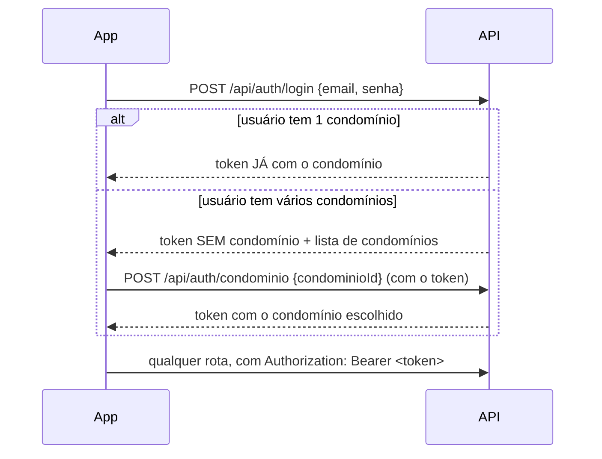

# Etapa 3 — Login com JWT e separação por condomínio

- **Branch:** `feature/autenticacao` (criada a partir de `feature/cadastro-base`)
- **Concluída em:** 13/11/2026

## Objetivo

Permitir que usuários entrem no sistema e garantir que cada um só enxergue os dados do condomínio
em que está. Com isso, a fundação fica completa.

## Como funciona o login



O mesmo `POST /api/auth/condominio` serve para **trocar** de condomínio depois.

### Endpoints

| Método | Rota | Acesso | O que faz |
|---|---|---|---|
| POST | `/api/auth/login` | aberto | Entra com e-mail e senha |
| POST | `/api/auth/condominio` | logado | Escolhe ou troca o condomínio; devolve um novo token |
| GET | `/api/eu` | logado | Mostra o usuário, o condomínio atual e os perfis |

Resposta do login e da troca:

```json
{
  "token": "eyJhbGciOiJIUzI1NiJ9...",
  "tipo": "Bearer",
  "expiraEm": "2026-11-14T06:14:15Z",
  "condominioId": null,
  "perfis": [],
  "condominios": [
    { "id": "01a1...", "nome": "Centro Comercial Exemplo", "perfis": ["SINDICO"] },
    { "id": "01a1...", "nome": "Residencial Exemplo", "perfis": ["SINDICO"] }
  ]
}
```

Erros seguem o padrão RFC 9457 (`application/problem+json`), por exemplo:
`{"status":401,"title":"Unauthorized","detail":"E-mail ou senha inválidos"}`.

### Regras de acesso

| Rotas | Regra |
|---|---|
| Login, `/actuator/health`, `/actuator/info`, Swagger | Abertas |
| `/api/auth/**`, `/api/eu` | Precisa de token |
| Todo o resto (documentos, financeiro, reservas...) | Precisa de token **com condomínio selecionado**; senão, 403 |

### O token (JWT)

Assinado com HS256 usando o segredo `condomix.seguranca.jwt.segredo`. Vale 12 horas (`validade`).

| Campo | Conteúdo |
|---|---|
| `sub` | id do usuário |
| `email` | e-mail do usuário |
| `condominio` | id do condomínio selecionado (ausente se ainda não escolheu) |
| `perfis` | perfis nesse condomínio, ex.: `["SINDICO"]`. Viram `ROLE_SINDICO` no Spring Security |
| `iss`, `iat`, `exp` | emissor, emissão e expiração |

## Separação dos dados por condomínio

É feita pelo próprio Hibernate, não por cada consulta. Assim, ninguém precisa lembrar de colocar
`where tenant_id = ?`: se esquecer, o filtro está lá do mesmo jeito.

1. As entidades com dados de condomínio têm o campo `tenantId` marcado com `@TenantId`
   (`Assinatura`, `Unidade`, `Pessoa`, `VinculoUnidade`, `PerfilAcesso`).
2. O `FiltroDeTenant` lê o condomínio do token e roda o resto da requisição dentro dele
   (`TenantAtual.executarComo(...)`).
3. O `ResolvedorDeTenant` informa esse condomínio ao Hibernate, que então:
   - acrescenta `tenant_id = <condomínio>` em **todas** as consultas dessas entidades;
   - recusa gravar um registro de outro condomínio.

| Situação | O que o Hibernate faz |
|---|---|
| Condomínio selecionado | Filtra por ele |
| Nenhum condomínio | Usa um id inexistente: consultas voltam vazias e gravações falham |
| Modo sistema (`TenantAtual.comoSistema`) | Sem filtro. Só para rotinas internas, como o login buscar os perfis do usuário em todos os condomínios |

**Cuidado ao programar:** o Hibernate lê o condomínio quando a transação **começa**. Por isso
`executarComo` e `comoSistema` devem envolver a transação, nunca ser chamados dentro de um
método `@Transactional`.

O `TenantAtual` usa `ScopedValue`, novidade do Java 25: o valor existe só dentro do bloco e some
sozinho ao sair, sem risco de "vazar" para a próxima requisição atendida pela mesma thread.

## Outras decisões

- **Novo módulo `compartilhado`:** guarda o `TenantAtual`, que todos os módulos vão usar. Não depende de ninguém.
- **Senhas com BCrypt**, no formato `{bcrypt}$2a$...`, o que permite trocar de algoritmo no futuro.
- **Mensagem de erro igual** para e-mail inexistente e senha errada, e com o mesmo tempo de resposta,
  para não revelar quais e-mails estão cadastrados.
- **Perfis de execução:**
  - `dev`: padrão na sua máquina. Tem um segredo JWT de desenvolvimento e cria dados de exemplo.
  - `test`: usado pelos testes automatizados.
  - `prod`: precisa da variável `JWT_SEGREDO`. Sem ela, a aplicação não sobe.

## Dados de exemplo (perfil dev)

Criados automaticamente na primeira execução (`DadosDeDesenvolvimento`):

| Login | Senha | Situação |
|---|---|---|
| `sindico@condomix.dev` | `condomix123` | Síndico de 2 condomínios: precisa escolher um |
| `morador@condomix.dev` | `condomix123` | Morador do apto A-101 do Residencial Exemplo: entra direto |

## Como verificar

```bash
./mvnw test
```

Resultado esperado: 15 testes passando, entre eles:
- `AutenticacaoTests`: senha errada, dados inválidos, sem token, login direto, escolha de condomínio,
  condomínio sem acesso e bloqueio de rotas sem condomínio;
- `CadastroBaseTests`: um condomínio não enxerga nem grava dados de outro.

Na aplicação rodando, abra o Swagger em http://localhost:8080/swagger-ui/index.html. Faça o login,
copie o `token`, clique em **Authorize** e cole o token.

## Pendências para etapas futuras

- **Renovação do token (refresh token):** hoje, depois de 12 horas, é preciso entrar de novo.
- **Limite de tentativas de login**, para dificultar ataques de força bruta.
- **Bloquear o acesso** de condomínios com assinatura suspensa ou cancelada (hoje só `ativo = false` bloqueia).
- **Cadastro de usuários pela API** (convite por e-mail, "esqueci minha senha").
- **Desligar o Swagger em produção** (`springdoc.api-docs.enabled=false`).
